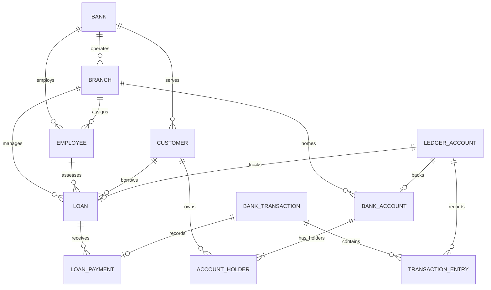

# Banking and Transaction Management Database

This PostgreSQL database is the primary deliverable for the mid-term project.
The existing C++/Qt application is deliberately not changed; it can be considered
later as an optional client of this database.

## Scope and assumptions

- The project models one bank with multiple branches, including branches in
  different cities.
- An account has one home branch but may be accessed through other branches.
- A customer may hold multiple accounts. An account may have multiple holders.
- Personal and business customers share a customer identity and have
  type-specific required fields.
- Account balances are derived from posted ledger entries, not stored as a
  separately editable balance.
- Every posted transaction has balanced, immutable ledger entries. Transfers
  debit and credit the two customer accounts in the same database transaction.
- A loan is associated with one borrower, one loan officer, one branch, one
  disbursement account, and a loan-receivable ledger account.
- Currency is explicit. The sample data uses USD solely for demonstration.
- This is an educational design, not a production banking or accounting system.

## Files

- `01_schema.sql` — tables, keys, constraints, indexes, views, posting guards,
  and atomic account/loan posting functions.
- `02_sample_data.sql` — small synthetic Riverstone Bank dataset, including
  branches, employees, customers, accounts, deposits, a transfer, and a loan
  disbursement/repayment.
- `03_demo_queries.sql` — SQL demonstrations corresponding to the relational
  algebra examples below.
- `04_integrity_tests.sql` — repeatable assertions for sample balances,
  transaction balancing, loan state, and rejected invalid operations.

## Create and load the database

Create a new, empty PostgreSQL database, then run these files in order with
`psql`:

```powershell
createdb banking_midterm
psql -d banking_midterm -f database\01_schema.sql
psql -d banking_midterm -f database\02_sample_data.sql
psql -d banking_midterm -f database\03_demo_queries.sql
psql -d banking_midterm -f database\04_integrity_tests.sql
```

The schema script is intended for a new database, not for repeated execution
over an existing schema. The sample data uses stable business keys and can be
rerun to fill missing sample records; its transaction references are unique.

## Main relational model

| Relation | Purpose and key relationships |
|---|---|
| `bank` | Bank identity; one bank has many branches, employees, customers, and ledger accounts. |
| `branch` | A bank location; referenced by accounts, employees, loans, and transactions. |
| `employee` | Bank staff assigned to a branch; may have a manager who is another employee. |
| `customer` | Personal or business customer details, constrained by `customer_type`. |
| `bank_account` | Account product, home branch, currency, status, and overdraft/rate settings. |
| `account_holder` | Many-to-many customer/account ownership, including joint owners. |
| `ledger_account` | Customer-deposit ledgers and system counterpart ledgers. |
| `bank_transaction` | Transaction header, status, unique reference, initiator, and optional loan. |
| `transaction_entry` | Signed changes to ledger accounts; each posted transaction balances to zero. |
| `loan` | Borrower, officer, branch, terms, status, and loan-receivable ledger. |
| `loan_payment` | A repayment record associated with its posted transaction. |



Every bank account and loan uses exactly one dedicated ledger account. Other
ledger accounts are system counterpart accounts; a posted transaction must
have at least two balanced entries.

Important database protections include:

- Primary and foreign keys, including composite foreign keys that prevent
  cross-bank relationships.
- `CHECK` constraints for account/customer types, currencies, loan amounts,
  status/date combinations, and non-negative limits.
- Unique customer, account, employee, loan, and transaction reference numbers.
- `NUMERIC(19,2)` for money.
- `account_balances` and `loan_balances` views, computed from posted entries.
- Deferred validation that rejects unbalanced or incorrectly shaped posted
  transactions.
- Triggers that prevent changes to posted transactions and their ledger entries.
- Product constraints for savings withdrawal limits, checking overdrafts, and
  fixed-deposit term/early-withdrawal settings.
- Posting rules that enforce savings monthly debit limits (including transfers
  and loan repayments), apply a fixed-deposit early-withdrawal penalty, and
  restrict fixed-deposit funding to its opening deposit.
- Posting functions that lock accounts and make transfers atomic.

The database owner can always alter objects or bypass application-level
permissions. For a deployed system, use a separate application role, grant it
only `EXECUTE` on approved posting functions and `SELECT` on needed views, and
do not grant direct writes to the ledger tables.

## Relational algebra examples

Notation: `σ` = selection, `π` = projection, `⋈` = join. `AccountBalances` is
the `account_balances` view. The expected values below are from the supplied
sample data.

### 1. Find Amina's open accounts and balances

```text
π customer_number, account_number, account_type, current_balance
  (σ customer_number='CUST-001' AND status='OPEN' AND removed_at IS NULL
    (Customer ⋈ AccountHolder ⋈ BankAccount ⋈ AccountBalances))
```

This combines selection, projection, and joins. Expected rows:

| Customer | Account | Type | Balance |
|---|---|---|---:|
| CUST-001 | ACC100001 | CHECKING | 2300.00 |
| CUST-001 | ACC100002 | SAVINGS | 5200.00 |

### 2. Show posted transactions affecting ACC100001

```text
π reference, transaction_type, amount
  (σ account_number='ACC100001' AND status='POSTED'
    (BankAccount ⋈ TransactionEntry ⋈ BankTransaction))
```

This retrieves the account's posted ledger activity. Expected entries include
`SEED-DEP-100001 / DEPOSIT / +2500.00` and
`SEED-TRF-100001 / TRANSFER / -200.00`.

### 3. List approved or active loans with borrower names

```text
π loan_number, customer_name, branch_code, status, principal
  (σ status='APPROVED' OR status='ACTIVE'
    (Loan ⋈ Customer ⋈ Branch))
```

This selects loans by status and joins their borrower and branch. The sample
result is `LN-2026-001`, borrower `Katanga Supplies SARL`, branch `LUB-CBD`,
status `ACTIVE`, principal `25000.00 USD`, and outstanding balance `24500.00`
after a sample repayment of `500.00`.

The algebra is conceptual relational notation. SQL implementations are in
`03_demo_queries.sql`.

## Demo transaction examples

```sql
SELECT post_deposit(
    (SELECT account_id FROM bank_account WHERE account_number = 'ACC100001'),
    125.00, 'DEMO-DEP-001'
);

SELECT post_transfer(
    (SELECT account_id FROM bank_account WHERE account_number = 'ACC100001'),
    (SELECT account_id FROM bank_account WHERE account_number = 'ACC100002'),
    50.00, 'DEMO-TRF-001'
);

SELECT post_loan_repayment(
    (SELECT loan_id FROM loan WHERE loan_number = 'LN-2026-001'),
    (SELECT account_id FROM bank_account WHERE account_number = 'ACC100004'),
    100.00, 'DEMO-LOAN-PAY-001'
);
```

The functions reject non-positive amounts, closed/frozen accounts, incompatible
bank/currency pairs, and withdrawals/transfers/repayments beyond the available
balance plus any configured overdraft limit. Loan functions require the borrower
to hold the designated account. Each function call is atomic. Loan disbursement
is only allowed once for an approved loan.
